<div align="center">



**An LLM judge that reads the probability of each rating instead of letting the model write the score.**

[](https://github.com/michaelinghilterra-creator/TheGavel/actions/workflows/test.yml)


</div>

## Why

A judge is a long prompt and a tiny answer. Most inference engines are tuned for the opposite, so a judge spends its time making the model write a report it only needs seven digits from.

TheGavel walks the model to each spot where a rating goes and reads the probability of every digit. You get:

- **A continuous score and a confidence number** (expected value, most likely digit, spread) instead of one sampled digit.
- **Output that can't break.** TheGavel writes the JSON; the model only fills values.
- **About a twentieth of the generated tokens.** The prompt still has to be read, so prefill, not decode, is the bottleneck.
- **Byte-identical scores, if you want them.** The native backend does the same arithmetic in the same order every time.

## Measured results

Job postings scored against a long hiring rubric. The reference scores came from a stronger model's full written evaluations, not human labels.

| Test | Writing its own report | TheGavel |
|---|---|---|
| 44 postings: generated tokens per posting | 579 | **28** |
| 44 postings: throughput | 1x | **1.65x** |
| 44 postings: malformed outputs | some, in early runs | **0** |
| 180 unseen postings: false positives | 24.5 of 60 | **17.5 of 60** |
| 180 unseen postings: strong roles kept | 56 of 60 | **57 of 60** |
| 180 unseen postings: Spearman with the reference | 0.74 | **0.77** |

Model: Qwen3.6-35B-A3B (NVFP4) on SGLang, on an NVIDIA DGX Spark. Means of two runs each.

**On an 8 GB laptop GPU** (RTX 4060 Laptop) with Qwen3-1.7B and the native backend: 44 long items (prompts of about 22,000 tokens) at about 14 seconds each, and two full runs were byte-identical. Small models judge a hard rubric poorly (Spearman 0.33 there, against 0.83 for the 35B model), so use the largest full-attention model that fits.

## Install

Install from GitHub:

```console
pip install "thegavel @ git+https://github.com/michaelinghilterra-creator/TheGavel"
```

Add an extra for the features you need:

```console
pip install "thegavel[server] @ git+https://github.com/michaelinghilterra-creator/TheGavel"
pip install "thegavel[native] @ git+https://github.com/michaelinghilterra-creator/TheGavel"
pip install "thegavel[dev] @ git+https://github.com/michaelinghilterra-creator/TheGavel"
```

The PyPI package named `gavel` is an unrelated project. Both use the import name `gavel`, so do not install both in one environment.

## Two-minute demo, no GPU

Clone the repository, install it, and score the example reviews against a built-in mock server:

```console
git clone https://github.com/michaelinghilterra-creator/TheGavel
cd TheGavel
pip install -e .
python examples/demo.py
```

Each output line is one scored review. The mock returns made-up probabilities, so the numbers show the format, not a judgment.

See [examples/README.md](examples/README.md) for commands for every backend.

## Backends

The chat backend is the default. It works with any OpenAI-compatible server that supports logprobs and `continue_final_message`, such as SGLang or vLLM. Select it with `--backend openai` and set `--base-url`, `--model`, and, when needed, `--api-key`.

The completions backend is for engines that do not support `continue_final_message`. Select it with `--backend completions` and provide either `--tokenizer` or `--prompt-format chatml`. It also accepts `--template-kwargs` when a tokenizer template needs extra values.

The native backend loads an in-process Hugging Face model. It is deterministic by construction and accepts full-attention models only. Hybrid and sliding-window models are refused. Install the `native` extra, then select `--backend native` with `--model-path`. You can also set `--device`, `--dtype`, and `--chunk`.

## Writing a rubric

A rubric is YAML. It needs a `name`, one or more `dimensions`, and exactly one of `preamble` or `preamble_file`. Each dimension has a `key` and can set `label`, `min`, `max`, and `weight`. A dimension can also set both `cap_below` and `cap_to` to cap the total when its expected value is low. The optional `threshold` controls the `pass` result.

Fields collect additional output. A field has a `key`, a `type` of `text` or `choice`, and an optional `max_tokens`. Choice fields need a list of single-token `choices` and can include `meaning`. Set `after: true` when a field depends on the completed ratings.

```yaml
name: quennox-reviews
preamble: Score fictional product reviews from Quennox Ratchet Works.
threshold: 3.5
fields:
  - key: verdict
    type: choice
    choices: [keep, reject]
    meaning: Whether the review is useful
    after: true
dimensions:
  - key: clarity
    label: Clarity
    min: 0
    max: 5
    weight: 2
  - key: accuracy
    label: Accuracy
    min: 0
    max: 5
    cap_below: 2
    cap_to: 2.5
```

## Output

Each result line is JSON. It contains the input `id`, rubric name, collected `fields`, and a `ratings` object. Every rating reports its expected value as `ev`, most likely digit as `argmax`, standard deviation as `sd`, captured probability `mass`, and normalized `probs`. Explain mode also includes evidence. Choice fields appear in `choices` with `value`, `mass`, and `probs`. The line ends with the weighted `score`, any `capped_by` dimensions, and `pass` when the rubric has a threshold.

## Commands

`gavel score RUBRIC ITEMS` scores JSONL items. `gavel bench RUBRIC LABELLED` compares scores with numeric labels over one or more runs. `gavel serve --rubric RUBRIC` starts the HTTP API. The server binds to `127.0.0.1` by default, has no authentication, and must not be exposed to a network. See [SECURITY.md](SECURITY.md).

## Engine notes

Logprobs are required. Engines that ignore `continue_final_message` need the completions backend. Prompt caching decides speed, so put the shared preamble first and keep it byte-identical across items.

## Tips

Tell the model the output format. TheGavel adds a format section for you. Read anything numeric as a choice field instead of free text. Put fields that depend on ratings after them with `after: true`.

## License

MIT. See [LICENSE](LICENSE).
